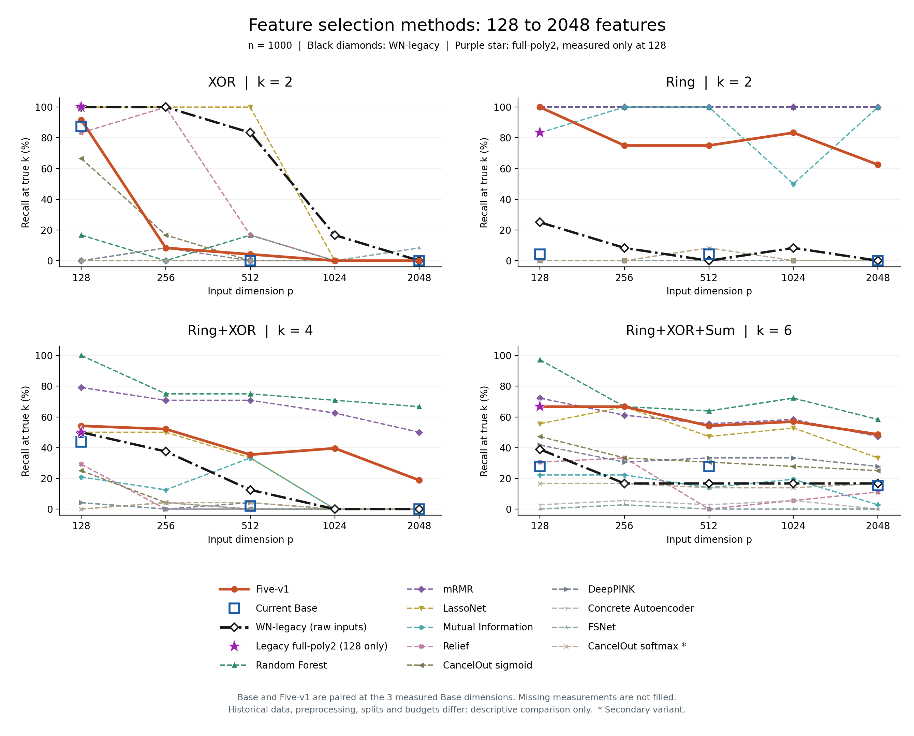
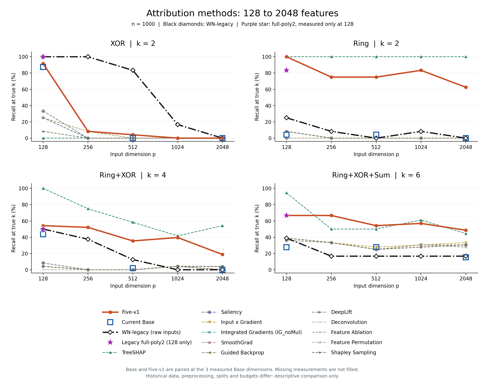

# XOR / Ring 研究线程总结

整理日期：2026-09-20；实验截止 2026-09-18。此目录将本线程的结论、会议汇报及来源快照整理到 main，便于继续讨论，不改变 main 的模型实现或默认方法。

## 当前结论

五项版明显改善了 Base 的 Ring 和混合任务特征选择，因此保留为研究版本；但还没有找到同时保护 XOR、改善 Ring 的最小不退化方案。高维 XOR 仍是主要短板，DAG 也没有一致收益。不能将“保留版本”写成“通过原门槛”或“证明最小”。

累计已审计选择器为 **4080**，另有 **24** 次已完成的选后重训。用户在 09/18 暂停新增实验，此次总结与合入不恢复训练、不修改已关闭实验的判据。

## 方法名称与区别

| 名称 | 输入与 gate | 本线程中的用途 |
|---|---|---|
| 当前基线 Base | 原始输入；ADMM 与最终排名使用有效 gate，即原始 gate 乘第一层权重长度 | 当前方法参照，默认未被候选替代 |
| 五项版 Five-v1 | 线性和中心化平方通道共享父特征 gate；有效 gate 使用两通道合并权重长度 | 已固定的研究候选 |
| 旧 Ring 全多项式版 Legacy-poly2 | 原始、平方、交叉项各有独立 gate；最终聚合回原始特征 | 与汇报算法表一致的无 warm-up 历史配置，目前核实的完整四任务结果在 128 维 |
| 历史 WN-legacy | 仅原始输入；按保留实现使用 gate 与权重范数的幅值读出 | 128—2048 维旧结果参照；历史运行源码身份未完全闭合 |

**两条 legacy 不能混用。** WN-legacy 的高维曲线不能接在 Legacy-poly2 的 128 维结果后面。尚未找到对应 Legacy-poly2 配置的高维完整结果，不能由此推断它高维效果差。

五项版固定的改动是：局部平方、线性权重默认初始化、隐藏层 dropout、平方仅中心化、非 gate 参数 Adam weight decay=0.001。平方权重为零，从第一轮开始学习；没有交叉项。平方中心化减去的是该平方列的训练折均值，不再除以平方列标准差；原始输入的训练折标准化仍保留。

五项版沿用 Base 的一次 20 轮 warm-up、五阶段各 20 轮 ADMM、C=0.05/0.2/0.8/3.2/12.8、rho=50、Adam lr=0.005。它借鉴部分旧配置，并非完整还原旧算法。

## 128 维的关键结果

以下 Base/Five 来自 R58 同批配对；旧全多项式版来自一个历史实例六折，作为非配对参照。数值为选中真实特征数 / 机会总数，分母不同不能直接比较命中数大小。

| 任务 | 旧 Ring 全多项式版 | Base | Five-v1 |
|---|---:|---:|---:|
| XOR | 12/12 | 23/24 | 22/24 |
| Ring | 10/12 | 0/24 | 23/24 |
| Ring+XOR | 12/24 | 13/48 | 27/48 |
| Ring+XOR+Sum | 24/36 | 21/72 | 44/72 |

R58 固定含 WD 家族的 12 个候选均未通过原门槛；五项版仅违反 XOR 坐标保护，条件式独立确认未启动。相对少一项的 M23，五项版 XOR/Ring 持平，两个混合任务分别多命中 1、2 个坐标，这构成保留第五项的实际收益，但不证明各项独立有效或全局最小。

R56 的四项新数据确认曾为 XOR 24→22/24、Ring 1→20/24；R59 的另一批五项结果为 XOR 24/24、Ring 23/24。各轮数据不同，不能挑选有利数值拼成同一次配对比较。

[完整 128 维 baseline 表](baseline_128_table.md)按四任务等权平均 recall 排序，共 25 种方法。该表使用 R61/R62 的 Base/Five 配对数据，因此与上面的 R58 数值不同；两条 legacy 和外部 baseline 均为非配对历史参照。

## 高维与 DAG

| 维度 | Five-v1 XOR | Five-v1 Ring |
|---:|---:|---:|
| 64 | 24/24 | 24/24 |
| 128 | 22/24 | 24/24 |
| 256 | 2/24 | 18/24 |
| 512 | 1/24 | 18/24 |
| 1024 | 0/24 | 20/24 |
| 2048 | 0/24 | 15/24 |

R61 的 512/2048 维四任务等权平均 recall：Base 6.16%，Five 37.33%；总体收益不能掩盖 XOR 失效。DAG 主指标 Top7 为 7/42→7/42，Top81 为 49/486→43/486，没有一般高维或 DAG 优势的证明。

黑色菱形线为 WN-legacy，紫色星号为 Legacy-poly2 的 128 维实测点。Base 仅画已有的 128/512/2048 维点；不补值、不拼接旧版本。全部图点源自已保存结果，比较仅作描述性参照。

## 高维 XOR 的定位与已完成尝试

- 固定模型扰动显示：部分 256 维失败折已依赖两个真特征，但 gate 的 Top2 没有选全；所查 512 维模型则几乎不依赖真特征。不能把全部失败归为最后的排名问题。
- 噪声依赖在 warm-up 结束时已经出现，不能笼统归因于后续 ADMM。尚未唯一定位平方、WD、dropout 或优化器的独立作用。
- R64 延长既有终点 C 的训练至 1200 轮，没有恢复所查的 512 维 XOR；该实验使用内层训练划分，与后续完整外层折实验分开。
- R67 慢路径采用 lr=0.001、warm20、5×100 ADMM。Ring512 18→23/24，但 Ring256 18→17/24、XOR512 1→0/24。用户保留为 Five-SlowPath-v1 候选，不改写共同判定失败。
- R68 迁移旧全局 C 并加长阶段、R69 重置 Adam/ADMM 状态、R70 每阶段加 warm-up，都没有找到同时改善高维 XOR 并保护 Ring 的方案。
- R70 的 StageWarm20：XOR256 2→2/24、XOR512 1→0/24；Ring256 18→18/24、Ring512 18→21/24。

旧 WN-legacy 的 XOR256/512 曾为 12/12、10/12，但 Ring 为 1/12、0/12。它提供研究线索，不能直接当作兼顾两任务的解法。R63 同内层划分的 LassoNet 高维 XOR 为 24/24，但原生预算和读出不同，不能据此认定某个单一机制；用户后来将探索重点转回自身旧 XOR 成功路径。

## 0906 已讲过的 score / gate 工作

0906 已完成有效 gate 与权重的关系、吸收 gate 的静态等价推导，以及有／无 gate 的 A/D 对照；也比较了终点梯度、曲率、实际删除和训练历史评分。A/D 未建立独立 gate 的稳定优势，所查替代评分没有修复当时的 Ring。不能把这些工作重新写成“尚未回答”。

尚未完成的是更具体的后续方向：将梯度等动态评分主动用于训练反馈，形成新算法并验证。旧代码名为 `score` 的权重范数只是调节收缩阈值；它与 ADMM 跟踪对象、最终 Top-k 分数应分开。不能将旧阈值开关实验当作已经完成主动评分算法比较。

## 汇报约定与继续工作的边界

- 面向 0906 的听众，先介绍方法与五项版，再讲结果，不假定老师知道实验编号。
- 主文保留算法对照后直接讲结果；五项版形成过程给日志入口，GPU 重现细节留作复查。低 AUC 是否说明已选 Ring 特征无效的小节已按用户要求移除。
- 算法表用简洁中文流程；重要差异加粗，相同步骤仅写“同 Base”。数据划分与标准化放在方法表外。
- Top-k 为主指标。默认初始化无需展开 Kaiming 术语；不能混淆线性默认初始化与平方为零。
- 五项版和慢路径都是研究候选，默认、原失败判定、技术附录原始字节和全部失败记录保留。
- 下一步实验仍暂停；本次总结合入不是新训练、重新确认、默认提升或论文改写授权。

## 文档与复查

- [最终会议汇报](MEETING_REPORT.md)及[技术附录](TECHNICAL_APPENDIX.md)：便携副本中的直接链接已映射到本目录。
- [来源索引](PROVENANCE.md)：原工作区路径、SHA-256 与逐文件快照；完整过程日志也在其中。
- [导出清单](manifest.json)与[独立核对脚本](verify_bundle.py)。运行 `python verify_bundle.py` 可在不依赖训练环境的情况下检查文件身份、表格和图点。

本目录是研究文档与证据包，不是 main 模型实现的替换。来源文件保留原始字节，其内部相对链接和绝对路径仍属于原研究工作区；无需执行来源快照中的训练脚本。原训练 checkpoint 与大型运行载荷继续保留在本地研究目录，不随此总结重复提交。
