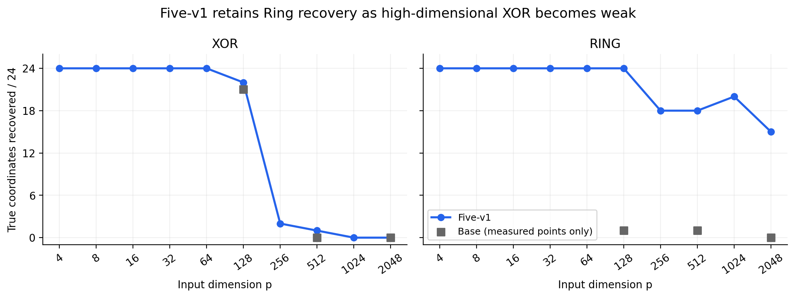
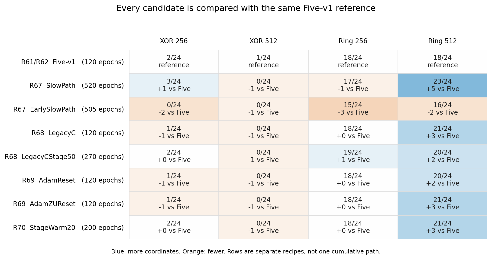
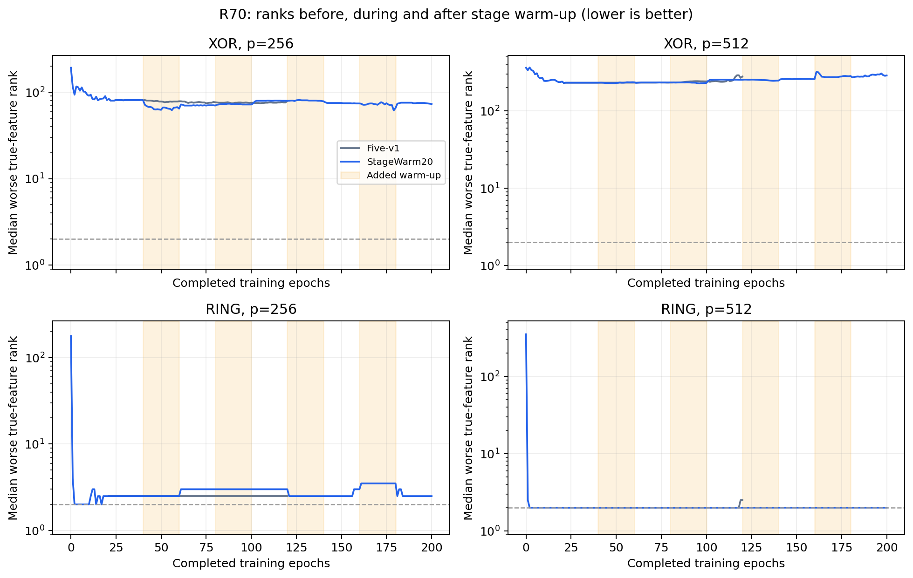

# GRN FS 五项版与高维特征选择阶段汇报

截至 2026 年 9 月 18 日。范围为五项版的保留、维度扩展、XOR 诊断，以及 R67—R70 的增量探索。当前按讨论决定暂停实验，保留已有版本与完整结果。

**本阶段结论：五项版对 Ring 和混合任务的特征恢复有明确的实验改善，但高维 XOR 仍是主要短板。降低学习率并延长阶段、迁移旧 C 数值、重置阶段状态、增加逐阶段 warm-up，都尚未得到同时改善高维 XOR 并保护 Ring 的方案。五项版值得作为研究版本保留，但不能称为原“不退化”门槛的胜出者，也没有证明最小改动。**

## 一 我们要解决什么问题

目标是让同一套方法同时选好 XOR 和 Ring 的真实特征，而不是为两个任务分别挑选有利配方。主指标是最终 Top-k 的真实特征恢复；完整恢复折数作为补充，AUC 用于辅助诊断，不代替特征选择结论。

最近的高维检查聚焦 p=256、512。每个任务维度有两份数据实例，每份做六折；XOR/Ring 各有两个真实特征，所以表中的 24 是 `2 实例 × 6 折 × 2 个真实特征` 的命中机会，完整恢复折数分母为 12。六折之间共享数据，不能把它们称为 12 份独立数据。

我们区分三个层次：

1. **探索性共同改进**：相对配对 Five-v1，四格的坐标命中和完整折均不下降、每实例坐标不下降，且两个 XOR 维度均严格提高。
2. **高维 XOR 做好**：两个 XOR 维度都达到 24/24，同时保护 Ring。仅多选中一个坐标不足以达到这个目标。
3. **最小改动成立**：出现有效方案后，还要检查更小子集或逐项删除，并在新数据上确认。一条累计路径出现收益，不能直接证明最小性。

这些是当前高维探索的判定；R58 原四任务不退化门槛独立保留，不能用后来的结果改写。

## 二 三类方法需要分清

**当前 Base** 是本轮所说的原方法参照：使用原始输入，以有效门 `g=a·s` 为 ADMM 坐标和最终读出，其中 a 是第一层输入列的范数，s 是可训练因子；使用全局 C 和 canonical signed RatioNorm prox。它有 RatioNorm 正则及 ADMM 增广项，只是没有五项版新增的隐藏 dropout 和 Adam weight decay。“没有额外 WD”不等于“没有正则”。

**Five-v1** 保留上述有效门、全局 C、规范 prox 和最终非零 `|g|` Top-k，在 Base 上采用以下五项配置。

| 改动 | 实际含义 |
|---|---|
| 局部平方 | 每个原始特征的线性与平方通道共享父特征 gate；没有交叉乘积项，平方权重从零开始 |
| 旧版默认初始化规则 | 线性权重按当前原始维数使用默认 Kaiming-uniform 抽样；不是旧网络的完整复现 |
| 隐藏层 dropout | 第一处 Mish 后加入 dropout，概率 0.043 |
| 平方只中心化 | 使用训练折的平方均值中心化，不再除以平方标准差；原始输入仍按训练折标准化 |
| Adam weight decay | 非 gate 参数含 bias 使用耦合 WD=0.001，gate 为 0；这项改变诊断优化目标 |

Five-v1 固定一次 warm20，加五个阶段各 20 轮 ADMM，共 120 轮；学习率 0.005、rho=50、batch64、两层宽度32的 Mish 网络。C 依次为 0.05、0.2、0.8、3.2、12.8。进入 ADMM 时按原流程新建 Adam、初始化 z/u，之后跨阶段连续保持状态。[版本定义][five-version]

**WN-legacy** 是更早的历史实现与结果线索。它与当前方法在共识坐标、逐坐标惩罚、近端更新、C/rho、阶段 warm-up 和状态重置等方面均有差异。因此，五项版并不等于“逐步还原完整 legacy”。尤其不能把旧 `C/score` 或旧近似收缩当作普通超参数直接搬入当前方法。[来源审计][r66-report]

## 三 五项版保留了什么收益

### 原四任务判定仍未通过

R58 的同批配对结果如下，均为 p=128。五项版显著改善 Ring 和混合任务，但 XOR 从 23/24 降到 22/24，仍然未通过原门槛。

| 任务 | 当前 Base | Five-v1 |
|---|---:|---:|
| XOR | 23/24 | 22/24 |
| Ring | 0/24 | 23/24 |
| Ring+XOR | 13/48 | 27/48 |
| Ring+XOR+Sum | 21/72 | 44/72 |

来源：[R58 Base 汇总][r58-base]、[R58 M31 汇总][r58-five]。R59 另一批数据中，同一五项配方得到 XOR 24/24、Ring 23/24，但该批没有 Base 对照，也没有混合任务，因此不能用这个 24/24 替换 R58 的配对结果。[R59 汇总][r59-data]

### 维度扩展揭示了高维 XOR 短板

Five-v1 已完成四任务共 42 个任务维度格的结果。下面单列 XOR/Ring 的完整维度走势；当前 Base 只画其已有的 128、512、2048 三个测量点。

| 维度 p | Five-v1 XOR | Five-v1 Ring |
|---:|---:|---:|
| 4 | 24/24 | 24/24 |
| 8 | 24/24 | 24/24 |
| 16 | 24/24 | 24/24 |
| 32 | 24/24 | 24/24 |
| 64 | 24/24 | 24/24 |
| 128 | 22/24 | 24/24 |
| 256 | 2/24 | 18/24 |
| 512 | 1/24 | 18/24 |
| 1024 | 0/24 | 20/24 |
| 2048 | 0/24 | 15/24 |

来源：[R61/R62 完整格数据][r62-data]。p=2 的 XOR/Ring 都为 24/24，但没有无关特征，因此不作为高维识别能力证据。不同维度使用的实例并不嵌套，不能仅凭局部非单调变化解释维度的因果作用。

R61 的配对比较进一步说明：在 512/2048 维、四个合成任务等权的宏平均 recall 上，Base 为 0.061632，Five 为 0.373264，收益成立；但这主要不能被解读为 XOR 已经做好。比如 XOR512 仅从 0/24 到 1/24，两者都很弱。[R61 汇总][r61-data]

**DAG 没有得到同样的提升。** 主读出 Top7 为 7/42→7/42，Top81 为 49/486→43/486。不能用合成任务宏平均提升掩盖 DAG 的不足，也不能称为因果特征恢复。[R61 DAG 结果][r61-report]

## 四 目前对失败原因了解到了哪一步

### Ring 的特征恢复收益有预测价值

R60 固定 R59 已选的两个原始特征，再用不含显式平方、gate 或 ADMM 的普通两输入 MLP 重训：测试 AUC 为 0.982133，真实两特征的 oracle 为 0.997602；原完整选择网络为 0.620720。这支持已选变量具有预测价值，也说明普通 MLP 在这些两输入条件下可以学好 Ring。[R60 汇总][r60-data]

因此，平方通道可以被理解为有帮助的表示设计，但不能把 Ring 改善直接称为“没有学到东西”。同样，重训同时改变了输入数、参数化、目标和正则，不能把 AUC 提升单独归因于去掉噪声或去掉 ADMM。

### XOR 存在两类不同问题

R65 对固定模型做输入扰动，观察模型是否实际依赖真实特征。

- **已经依赖真实特征，但门排名漏选。** 在 R63/R64 的内层训练协议下，256维 Base 有三个最终只选中一项真特征的折，测试 AUC 均值为 0.9535；分别打乱两个真特征后降到约 0.49/0.52。Five 也有一个类似折，真特征排名为 `[3,1]`。这些情况存在读出不完整。
- **尚未形成真实特征依赖。** 512维两方法在检查的 1200 轮终点，对真实特征对的置换几乎不改变输出，而对高分噪声对的置换明显敏感。这里不能只归咎于最终 Top2 截取。

此外，在初始 warm20 结束时，训练 AUC 已接近 1，但打乱全部噪声后降至约 0.50—0.52，说明训练拟合对噪声行对应的依赖在进入 ADMM 前就已存在。这些结果**并未把原因唯一定位到平方、WD、dropout、某个梯度项或某种正则坐标**。[R65 扰动结果及逐折出处][r65-report]

### 单纯延长现有终点训练不足以解决

R64 保留前 120 轮，再在最终 C=12.8 连续训练到 1200 轮：256维 Base 从 11/24 到 13/24，Five 从 3/24 到 1/24；512维两者均为 0/24。这只检验了固定终点延长，不覆盖所有训练路径。该批使用 R63 的内层90% fit，数值不能拼入上一节的完整训练折曲线。[R64 数据][r64-data]

## 五 从旧 WN 得到了哪些可检验线索

旧结果中存在较好的高维 XOR，但必须保留其数据与运行身份边界。

| 历史 WN-legacy 维度 | XOR | Ring |
|---:|---:|---:|
| 256 | 12/12 | 1/12 |
| 512 | 10/12 | 0/12 |

来源：[旧结果文件][legacy-data]与[R66 核查][r66-report]。这里是一个实例六折，分母12；它与当前两实例的分母24不是同一批配对实验。五月运行时的源码、环境和数据哈希没有完整闭合，后期保留源码不能冒充已认证的原运行时。

保留源码提供了具体差异：维度缩放的旧 C、每阶段更长训练、每阶段 warm-up、Adam/z/u 重置，以及 rho 与正则坐标等。我们据此从当前 Five 出发逐项或分组验证，而不是把完整 legacy 一次搬回。

R66 还排除了一项不必重训的候选：在 48 条已有高维 XOR 轨迹的 240 个阶段边界上，旧 raw-factor 0.01 阈值及末阶段 z 支持掩码均为全1。单独插入这套掩码不会改变这些轨迹；这不等于验证了完整旧 WN。

## 六 最近四轮增量探索的统一结果

R67—R70 复用同一组 R61/R62 完整外层训练折、数据和 seed。每个候选有48次选择，七个候选共336次，均已完成审计。下表每行都与同一个 Five-v1 参照比较，**不是从上一行继续叠加**。

| 配方 | 每次总轮数 | XOR256 | XOR512 | Ring256 | Ring512 |
|---|---:|---:|---:|---:|---:|
| Five-v1 | 120 | 2/24 | 1/24 | 18/24 | 18/24 |
| SlowPath | 520 | 3/24 | 0/24 | 17/24 | 23/24 |
| EarlySlowPath | 505 | 0/24 | 0/24 | 15/24 | 16/24 |
| LegacyC | 120 | 1/24 | 0/24 | 18/24 | 21/24 |
| LegacyCStage50 | 270 | 2/24 | 0/24 | 19/24 | 20/24 |
| AdamReset | 120 | 1/24 | 0/24 | 18/24 | 20/24 |
| AdamZUReset | 120 | 1/24 | 0/24 | 18/24 | 21/24 |
| StageWarm20 | 200 | 2/24 | 0/24 | 18/24 | 21/24 |

来源：[R67][r67-data]、[R68][r68-data]、[R69][r69-data]、[R70][r70-data]。完整折及逐实例检查均纳入各轮判定，七个候选均未通过共同改进筛选。

各轮实际改变如下。

- **R67 经验组合**：SlowPath 把学习率改为0.001、每阶段改为100轮，保留warm20；EarlySlowPath在它上面再把初始warm改为5轮。这是组合试验，不能据此单独确定学习率或时长的作用。
- **R68 旧 C 支线**：LegacyC只迁移旧全局C数值；256维为0.2/0.4/1/2/4，512维为0.4/0.8/2/4/5。LegacyCStage50在它上面再把阶段20改为50轮。没有引入旧逐坐标 `C/score`。
- **R69 状态支线**：从原Five开始，AdamReset只重置新阶段的Adam矩与计数；AdamZUReset再加入阶段开始时 `z=g、u=0`。两者均保持原C和总轮数120。
- **R70 warm-up 单项**：从原Five开始，在第2—5个C阶段前各加20轮监督训练，保留Adam状态，期间暂停z/u与prox更新。原ADMM仍100轮，总轮数增至200；没有混入R69重置。

**共同观察是：多项改动能改善 Ring512，但没有恢复高维 XOR。** 所有新增候选的 XOR512 均为0/24；XOR256最好也只是 SlowPath 的3/24，仍没有完整恢复的折。不能用 Ring 的提高或四格平均数抵消 XOR 的退化。

SlowPath 已按讨论保留为独立研究版本：Ring512 从18/24到23/24，完整折从6/12到11/12；同时明确保留 XOR512 的1→0和 Ring256 的18→17。其520轮成本约为原Five的4.33倍，不能称“XOR不受影响”。[SlowPath 版本][slow-version]

## 七 逐阶段 warm-up 告诉了我们什么

R70 记录了每段新增warm前、warm后、随后20轮ADMM结束时的排名。以下是三个有代表性的固定阶段，完整16组记录全部保留在[报告][r70-report]，没有用最佳中间时点替换终点。

| 任务与阶段 | 较差真特征排名中位数 warm前→后→随后ADMM | Top2命中变化 |
|---|---|---|
| XOR256 第二阶段 | 80.5 → 64.5 → 70.0 | 1 → 2 → 1 /24 |
| XOR256 第五阶段 | 74.0 → 65.5 → 73.0 | 2 → 2 → 2 /24 |
| XOR512 第五阶段 | 257.5 → 282.5 → 287.5 | 0 → 0 → 0 /24 |

排名数值越小越好。256维部分warm段让真实特征更靠前，但改善幅度不足以提高最终Top2；512维则没有出现相应的恢复。不能统一讲成“warm已经找对了，只是被ADMM全部破坏”，因为不同阶段的变化方向并不一致。

新增80轮同时改变了训练量和监督更新的插入时机，因此本批只支持对这份具体安排的结论。它不是同预算对照，也没有检验warm与阶段重置的全部组合。

## 八 当前可以汇报的结论与暂停位置

我们已经确认，局部平方等五项配置可以显著改善 Ring 和部分混合任务的特征恢复；但从128维到更高维度时，XOR恢复明显不足。高维失败既有“学到了真实依赖但门排名不完整”的情况，也有“没有形成真实依赖”的情况，不能用单一读出问题解释全部结果。

围绕旧 WN 的若干训练设置已经完成有界检验，尚未把其历史 XOR 优势转移到当前 Five。我们还没有确定唯一机制，也没有找到满足共同目标的最小方案。旧 WN 的数学坐标、近端更新、rho设置及因素交互仍是未完全拆开的差异；它们是后续讨论议题，不是已经确定有效的改进。

**当前决定是暂停新增训练，保留 Five-v1 和 SlowPath-v1 两个候选版本、所有失败记录及默认方法。** 没有启动新数据确认、扩大DAG测试或论文改写。若以后恢复探索，应先明确要检验的单因素或组合及其预算，再沿用Top-k共同判定，避免边看结果边改变目标。

## 附录 已有 LassoNet 比较的准确位置

R63 是三方法同一内层fit/validation/test划分的已完成诊断，使用外层训练折中的90%作为fit，与前面的R61/R62完整训练折不同。这里保留已有结果用于定位差距，不恢复当前暂停的LassoNet方向或新增训练。

| 维度 | Base | Five-v1 | LassoNet |
|---:|---:|---:|---:|
| 128 | 20/24 | 24/24 | 24/24 |
| 256 | 11/24 | 3/24 | 24/24 |
| 512 | 0/24 | 0/24 | 24/24 |

来源：[R63 原始汇总][r63-data]。LassoNet 的原生训练预算、路径更新与整条路径主读出不同于 GRN 的最终有效门；因此不能把差距唯一解释为网络容量、训练时长或ADMM。其初始排名不突出、后续路径仍能恢复，而当前方法在这些轨迹中没有表现出同样可靠的后续重排。哪一项机制负责仍需区分。[R63 路径诊断][r63-report]

## 附录 证据口径与复查入口

本次汇报只整理既有产物、重绘汇总图，没有训练、推理、重拟合或新增选择器。R67—R70合计336条选择、89,040轮正式训练；原Five参照直接复用。工程核验失败与正式结果分开保留，例如R69此前的无观测入口问题已留档，不能把“正式零失败”写成所有开发过程都从未失败。

截至R70，累计已审计4080条选择轨迹，其中4044条为本研究线及控制、36条为LassoNet；另有24次R60重拟合。该总数是跨实验记账，不能当作4080个独立重复，也不能用于声称统计显著性。关键运行使用确定性GPU、固定数据和seed，结果与源文件可追溯；版本/默认保持不变。

本汇报两张新图由[只读汇总脚本][asset-script]生成，表格来源哈希与核对结果保存在[evidence.json][report-evidence]。该文件及已有轮次审计是复查入口，不能将文档整理视为新实验确认。

主要证据可按问题查阅：

| 问题 | 入口 |
|---|---|
| 五项的精确定义与保留状态 | [Five-v1][five-version]、[SlowPath-v1][slow-version] |
| 原四任务不退化为何失败 | [R58报告][r58-report]及上文两臂原始汇总 |
| 完整维度与DAG | [R62完整维度][r62-report]、[R61配对迁移][r61-report] |
| Ring选后预测能力 | [R60重拟合][r60-report] |
| 高维XOR的函数依赖与排名 | [R65扰动][r65-report]、[R64时长][r64-report] |
| 历史WN结果与源码身份 | [R66来源审计][r66-report] |
| 七个候选的固定定义与结果 | [R67][r67-report]、[R68][r68-report]、[R69][r69-report]、[R70][r70-report] |

[five-version]: sources/52ad9334837743892872.md
[slow-version]: sources/c48e64e51045964a3c30.md
[r58-base]: sources/454b478541883eb244fb.json
[r58-five]: sources/6812a9c9a8a67caa68b5.json
[r58-report]: sources/7f6cf24a96adecb4dabf.md
[r59-data]: sources/35988ea70c1ac411140f.json
[r60-data]: sources/431c33b454784e35b7f5.json
[r60-report]: sources/d0abd25c8e1af38a09e0.md
[r61-data]: sources/e9f2126421bfbce5aedd.json
[r61-report]: sources/a4fa4fc9f6a7b5ef6371.md
[r62-data]: sources/4682e24c0dccdb4a9053.json
[r62-report]: sources/6579b792f9b5e37c885e.md
[r63-data]: sources/9478d2573780ad13563a.json
[r63-report]: sources/abeb9636b67c61339f19.md
[r64-data]: sources/5ee4c0928df1b9816581.json
[r64-report]: sources/3c9948a442aa23198d42.md
[r65-report]: sources/274ba2e5d2d07b856d30.md
[legacy-data]: sources/3b9482c6b236535a9dd2.json
[r66-report]: sources/03cb8bf8d7043c540d6d.md
[r67-data]: sources/d771b2a26239819e8a67.json
[r68-data]: sources/8e99488d225953d0c4f9.json
[r69-data]: sources/adfc38a541b8b8de76c4.json
[r70-data]: sources/dcfc34a8a0aac698915d.json
[r67-report]: sources/a0aff02bd37153fe4ade.md
[r68-report]: sources/2cfae8757e5b18e8b7cd.md
[r69-report]: sources/52997bc150d9ef5bb3fc.md
[r70-report]: sources/b217c867e11cbf8a28c9.md
[asset-script]: sources/510527179078b7fc82b7.py
[report-evidence]: sources/b2b31ec45f39b42174d0.json
